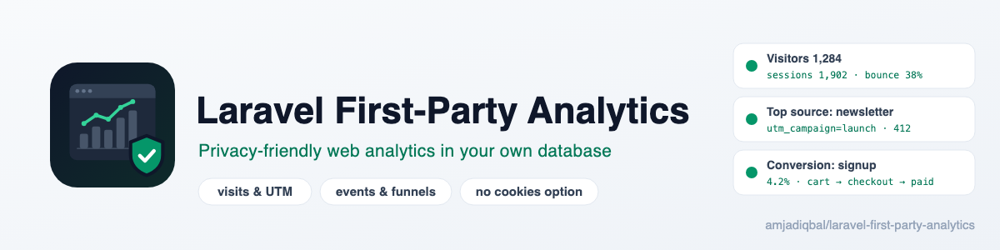
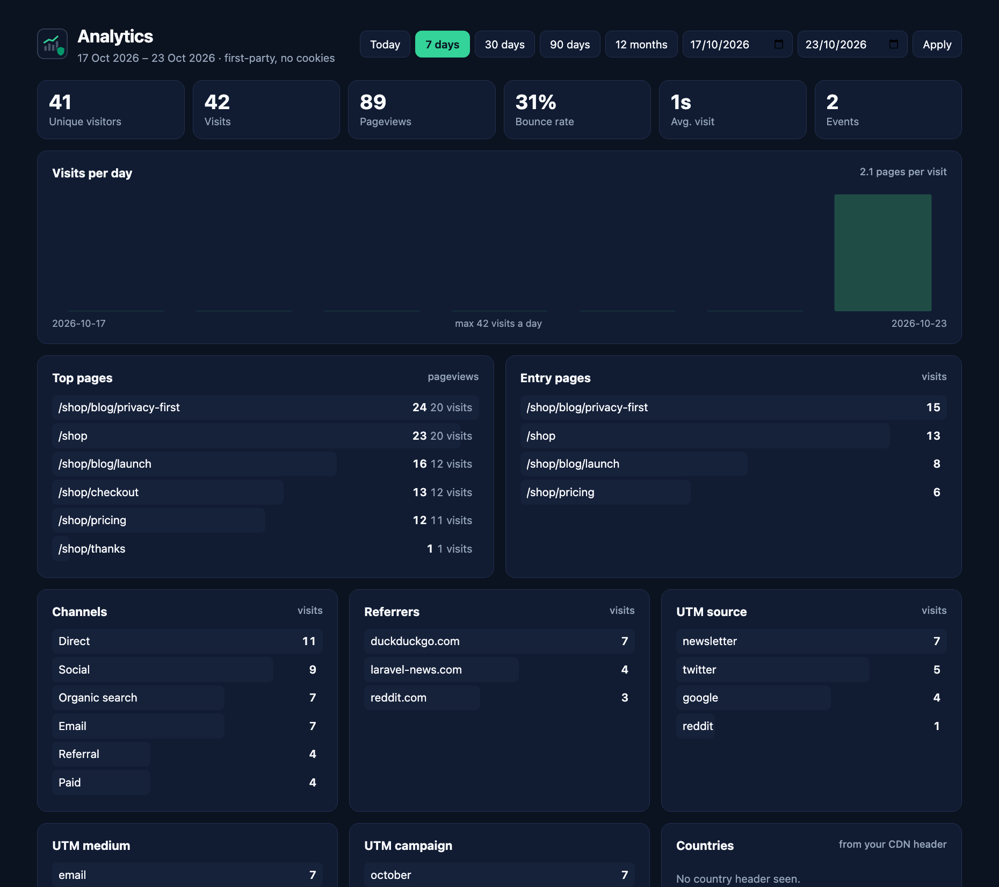

<p align="center">
  <picture>
    <source media="(prefers-color-scheme: dark)" srcset="art/banner-dark.png">
    
  </picture>
</p>

# Laravel First-Party Analytics: self-hosted, privacy-friendly web analytics in your own database

Know where your visitors come from and whether they convert, without Google Analytics, without a
third-party script, and without sending anyone's data anywhere. This package records **visits and
sessions, pages, referrers and UTM campaigns, custom events from PHP and JavaScript, conversions and
ordered funnels** in two tables of your Laravel app's own database, filters out bots, and shows it all on
a gated Blade dashboard.

Privacy is the default: **no cookies** unless you turn them on, IP addresses anonymised, Do-Not-Track and
Global Privacy Control respected, no raw user agents, query strings, request bodies or headers stored,
retention pruning built in, and **no network calls at all**. Writes happen after the response is sent (or
on your queue), in one batch per request.

Docs and demo: https://amjad.com.pk/laravel/packages/laravel-first-party-analytics

[](https://packagist.org/packages/amjadiqbal/laravel-first-party-analytics)
[](https://packagist.org/packages/amjadiqbal/laravel-first-party-analytics)
[](LICENSE.md)

<p align="center">
  
</p>

```bash
composer require amjadiqbal/laravel-first-party-analytics
php artisan migrate
```

That's it: every page your `web` routes serve is now recorded, and the dashboard is at `/analytics` in
your `local` environment. Give your team access in production with a gate (see [Access](#access)).

## Why another analytics package?

Rails has had [Ahoy](https://github.com/ankane/ahoy) for years. Laravel's options each cover a piece:
`pragmarx/tracker` logged everything (with ~10 writes per request) and has been abandoned since Laravel 8;
`shetabit/visitor` logs requests (including request bodies and raw IPs) but has no sessions, sources or
dashboard; `kyranb/footprints` does UTM attribution only. Laravel Pulse and Nightwatch measure your app's
**performance**, not your **visitors**. This package is the whole picture in one place, and it is
designed to collect as little as possible.

## Requirements

- PHP 8.3+
- Laravel 12 or 13
- Any database Laravel supports (tested on SQLite, MySQL 8.4 and PostgreSQL 17)

## What gets recorded

A **pageview** is a successful (2xx) HTML response to a `GET` request on a `web` route. Not recorded:
JSON and AJAX requests, Livewire updates, redirects, errors, prefetches (`Sec-Purpose: prefetch`),
the dashboard itself, and the paths in `exclude_paths` (`admin*`, `livewire/*`, `telescope*`, `horizon*`,
`pulse*`, `nova*`, `filament*`, `_debugbar/*`, `up`...).

A **visit** groups a visitor's pageviews and events. It ends after 30 minutes without a request
(`visit_minutes`), or when the visitor comes back from a new campaign or another site. Each visit stores:

| | |
|---|---|
| Landing page | path only, no query string |
| Source | `utm_source`, `utm_medium`, `utm_campaign`, `utm_term`, `utm_content` (or `?ref=` as the source), and the referrer: another site's URL **without its query string**, and its host |
| Device | browser, operating system and device type (desktop, mobile, tablet), parsed and then discarded: the user agent itself is never stored |
| Country | only from a header your CDN already sends (`CF-IPCountry` by default); no GeoIP lookups |
| IP | anonymised (last IPv4 octet / last 80 IPv6 bits zeroed), or `none`, or `full` |
| User | the signed-in user's id, if any |

**Bots are not recorded.** That covers crawlers, AI scrapers, uptime monitors, headless browsers,
`curl` and requests with no user agent ([jaybizzle/crawler-detect](https://github.com/JayBizzle/Crawler-Detect)).
To use your own check, bind `AmjadIqbal\FirstPartyAnalytics\Contracts\DetectsBots` in the container.

Payment and sign-in pages that send visitors back mid-visit (`checkout.stripe.com`, `paypal.com`,
`accounts.google.com`, `appleid.apple.com`) continue the visit instead of starting a new one. Add yours to
`ignore_referrers`.

## Privacy

| Option | Default | |
|---|---|---|
| `cookies` | `false` | No cookie is set. A visitor is a hash of the IP, user agent and host with a **salt that changes every day**, so nobody can be followed across days, and the IP is only hashed, never stored. The cache keeps a visit together. Set `true` (or `ANALYTICS_COOKIES=true`) for a first-party `fpa_visitor` cookie (365 days, `visitor_days`) and an `fpa_visit` cookie (30 minutes): then returning visitors are recognised, and a visitor's earlier anonymous visits are linked to them when they sign up. Both are `HttpOnly`, `SameSite=Lax` and encrypted like your other cookies. |
| `ip` | `anonymize` | `none` stores no IP; `full` stores it as is. |
| `respect_dnt` | `true` | Browsers sending `DNT: 1` are not recorded at all. |
| `respect_gpc` | `true` | Browsers sending `Sec-GPC: 1` are not recorded at all. |
| `retention_days` | `395` | `php artisan analytics:prune` deletes older visits and events. `null` keeps everything. |

Without cookies, "unique visitors" are unique per day: over a 30-day range the same person counts once per
day they visited.

Skip some visitors (your own team, for example) from a service provider:

```php
use AmjadIqbal\FirstPartyAnalytics\Facades\Analytics;
use Illuminate\Http\Request;

Analytics::ignoreUsing(fn (Request $request) => $request->user()?->is_staff === true);
```

Whether you need consent depends on your jurisdiction and on the options you choose; this package
gives you the settings, not legal advice.

## Custom events

### From PHP

```php
use AmjadIqbal\FirstPartyAnalytics\Facades\Analytics;

// Inside a request: joins the visitor's current visit.
Analytics::track('signup', ['plan' => 'pro']);

// From a job, a command or a webhook handler: stored for the user, without a visit.
Analytics::track('invoice_paid', ['amount' => 49], $user);
```

Properties are kept flat and small: up to 25 keys, scalar values, strings cut to 255 characters.
Names starting with `$` are reserved (`$pageview`).

### From the browser

Add the directive once, in your layout's `<head>` or before `</body>`:

```blade
@firstPartyAnalytics
```

It adds a small inline script (no file to load; a CSP nonce from `Vite::useCspNonce()` is applied) with:

```js
analytics.track('video_played', { video: 'intro' });  // also available as fpa.track(...)
```

and click tracking without any JavaScript of your own:

```html
<a href="/pricing" data-analytics-event="cta_clicked" data-analytics-button="hero">See pricing</a>
```

Events are sent with `navigator.sendBeacon` to `POST /fpa/event` (`js.endpoint`). The endpoint needs no
CSRF token, so instead it only accepts requests whose `Origin` is your own site, it is rate limited per IP
(`js.rate_limit`, 120 a minute), and it can be limited to the event names you list in `js.allowed_events`.
`analytics` is only set when no other script (such as Segment) already uses that name; `fpa` is always there.

## Users

When someone signs in (Laravel's `Login` event) or registers (`Registered`), their current visit is linked
to them. With cookies on, their earlier anonymous visits are linked too, so a signup can be attributed to
the campaign that first brought them in. For a custom flow, call it yourself:

```php
Analytics::identify($user);
```

## Conversions and funnels

```php
// config/first-party-analytics.php
'conversions' => ['signup', 'purchase'],

'funnels' => [
    'Checkout' => ['page:/pricing', 'checkout_started', 'purchase'],
    'Blog to signup' => ['page:/blog/*', 'signup'],
],
```

A conversion's rate is the share of visits in the range that reached that event. A funnel is **ordered**:
a visit counts for a step only after it completed the step before it, in the same visit. A step is an
event name, or `page:/path` for a pageview (`page:/blog/*` matches a prefix).

## The dashboard

`/analytics` (`dashboard.path`) shows, for today, 7, 30 or 90 days, 12 months or a custom range:

- unique visitors, visits, pageviews, bounce rate (visits with one pageview), average visit duration, events;
- visits per day;
- top pages and entry pages;
- channels (Direct, Organic search, Social, Email, Paid, Campaign, Referral), referrers, UTM source, medium and campaign;
- countries, devices, browsers and operating systems;
- custom events (click one to see its most common property values), conversions and funnels.

It is plain Blade with inline CSS: no build step, no JavaScript framework, light and dark mode.

### Access

The dashboard is behind the gate `viewFirstPartyAnalytics`, which allows the `local` environment only until
you define it:

```php
// app/Providers/AppServiceProvider.php
use Illuminate\Support\Facades\Gate;

Gate::define('viewFirstPartyAnalytics', fn ($user) => $user->is_admin);
```

The gate is checked after the dashboard middleware (`['web']` by default; add `auth` if you like), so
emptying that list cannot expose it.

## Writes and performance

Nothing is written while your page is being built. Everything a request records (the new visit, the
pageview, your events) is collected and inserted in one batch:

| `write` | |
|---|---|
| `after_response` (default) | after the response has been sent to the browser |
| `queue` | as one `RecordAnalytics` job per request on `queue.connection` / `queue.queue` |
| `sync` | immediately |

Console commands and queue jobs always write immediately (or queue). A failing write is reported to your
exception handler and never breaks the page. Reports are plain aggregate queries on the `started_at` and
`created_at` indexes.

## Retention

```php
// routes/console.php
use Illuminate\Support\Facades\Schedule;

Schedule::command('analytics:prune')->daily();
```

```bash
php artisan analytics:prune               # older than retention_days (395)
php artisan analytics:prune --days=90
php artisan analytics:prune --pretend     # count only
```

Deletes run in chunks of 1,000 rows.

## Configuration

```bash
php artisan vendor:publish --tag=first-party-analytics-config
```

Also publishable: `first-party-analytics-migrations` (to change the tables before migrating; table names and
the connection are in the config) and `first-party-analytics-views`.

| Key | Default | |
|---|---|---|
| `enabled` | `true` | `ANALYTICS_ENABLED=false` stops all recording |
| `auto_track` | `true` | adds the tracking middleware to the `web` group; set `false` and use the `analytics.track` middleware alias on the routes you choose |
| `exclude_paths` | see above | `Request::is()` patterns that are never recorded |
| `visit_minutes` | `30` | inactivity that ends a visit |
| `cache_store` | default store | where no-cookie visits are kept |
| `country_header` | `CF-IPCountry` | header with a two-letter country code |
| `database.connection` | default | a separate connection for analytics, if you like |
| `dashboard.top` | `10` | rows per list |

## Testing

```bash
composer test       # Pest
composer analyse    # PHPStan level 6
scripts/ci-local.sh # PHP 8.3/8.4/8.5 × Laravel 12/13, plus MySQL 8.4 and PostgreSQL 17 in Docker
```

## Need this built into your app, or something custom?

I build Laravel apps and the marketing and product analytics around them: tracking plans, attribution,
funnels and dashboards for the questions your team actually asks. If you would rather have someone set this
up with you, or you need something this package does not do,
[get in touch](https://amjad.com.pk/contact?utm_source=github&utm_medium=readme&utm_campaign=laravel-first-party-analytics).

## Support

- 🐛 **Bug or feature request**: [open an issue](https://github.com/amjadiqbal/laravel-first-party-analytics/issues)
- 🔒 **Security issue**: please report privately via GitHub's security tab

## Need this customised, or something built?

I'm available for custom development, package integration, and technical consulting.

[](https://www.upwork.com/freelancers/amjadkhatri)

## More packages

Part of a family of open-source packages. See [all of them](https://github.com/amjadiqbal?tab=repositories).

| | |
|---|---|
| [laravel-webhook-console](https://github.com/amjadiqbal/laravel-webhook-console) | Dashboard and replay tool for spatie/laravel-webhook-client |
| [laravel-mysql-advisor](https://github.com/amjadiqbal/laravel-mysql-advisor) | MySQL and MariaDB health checks with the SQL to fix each problem |
| [laravel-driver-js](https://github.com/amjadiqbal/laravel-driver-js) | Product tours and onboarding for Laravel |
| [kiln](https://github.com/amjadiqbal/kiln) | Deploy-time OPcache control for Laravel |

## Changelog

See [CHANGELOG.md](CHANGELOG.md).

## License

MIT. See [LICENSE.md](LICENSE.md).
